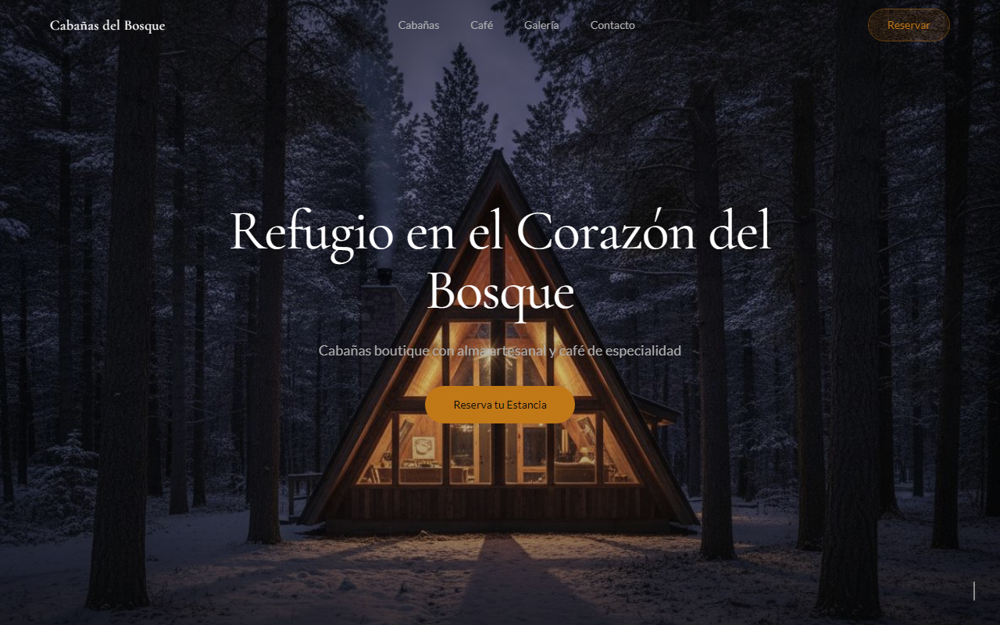

# 🌲 Cabañas del Bosque

[](https://github.com/Fernandamv96/cabanas-del-bosque/actions/workflows/ci.yml)


[](LICENSE)

Landing page de un complejo de **cabañas boutique con café de especialidad**: hero en video, cabañas, menú del café, galería, reservas y contacto, con animaciones al hacer scroll.

**Demo:** <https://cabanas-del-bosque.vercel.app>



## ¿Qué problema resuelve?

Le da a un negocio de turismo pequeño una vitrina inmersiva que transmite la experiencia (bosque, cabaña y café) y lleva al visitante a reservar.

## Stack

React 19 · TypeScript · Vite · Tailwind CSS 3 · shadcn/ui · GSAP + ScrollTrigger · Lenis (scroll suave) · Vercel

## Cómo correrlo localmente

```bash
cd app
npm ci
npm run dev       # http://localhost:5173
npm run lint      # ESLint
npm run build     # tsc + vite build
```

> En Vercel, el **Root Directory** del proyecto debe ser `app`.

## Estructura del proyecto

```text
app/
├── src/
│   ├── sections/       # Hero, About, Cabins, CafeMenu, Gallery, Booking, ContactFooter, Navigation
│   ├── pages/Home.tsx
│   ├── components/ui/  # componentes de shadcn/ui (generados)
│   ├── types/lenis.d.ts
│   └── App.tsx         # Lenis + GSAP ScrollTrigger
└── public/             # imágenes y video del hero
```

## Qué aprendí

- A coordinar Lenis con GSAP ScrollTrigger y a limpiar los listeners al desmontar.
- A tipar librerías sin tipos con un `.d.ts` propio en vez de usar `any`.
- A revisar los lockfiles: el anterior descargaba paquetes desde un mirror privado.

## Licencia

Código bajo [MIT](LICENSE) © 2026 Fernanda (Fernandamv96).
